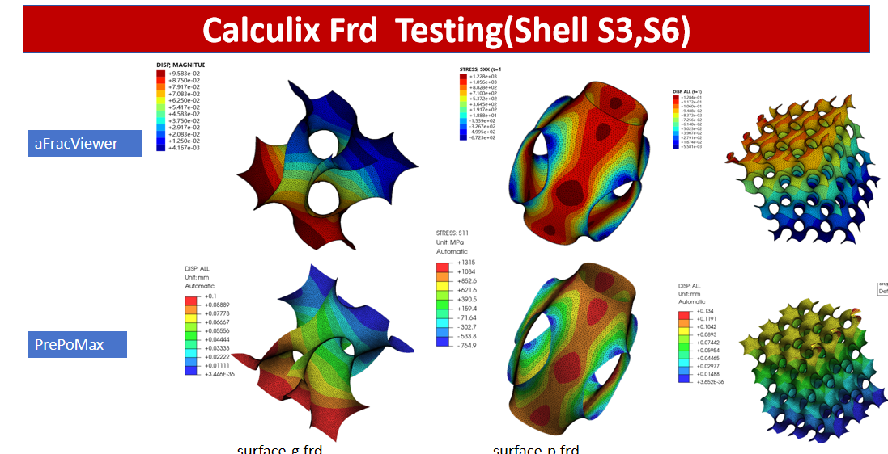
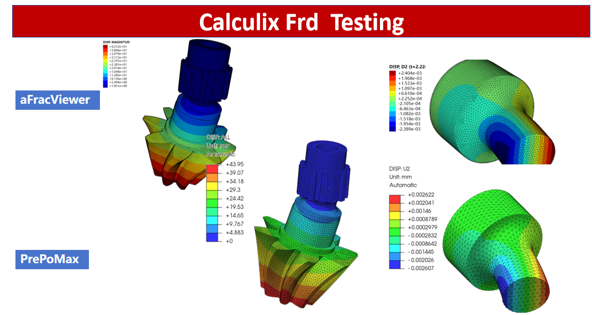
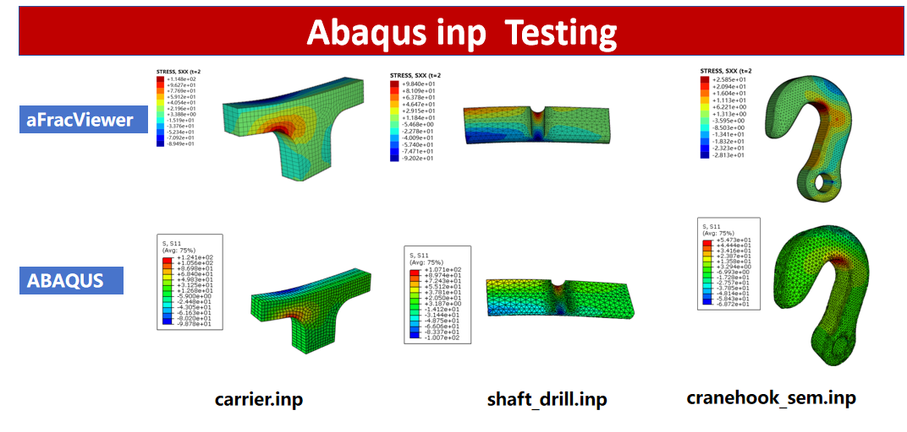
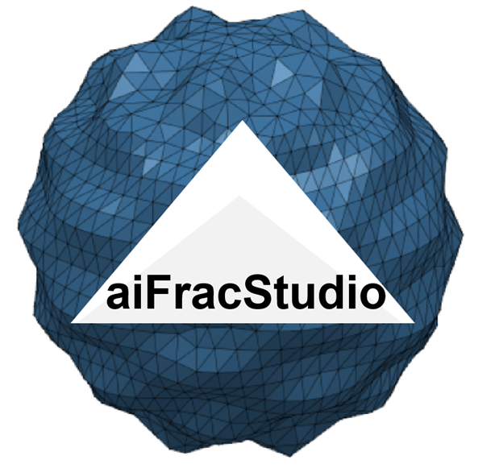

# aFracViewer — Abaqus & CalculiX Results Viewer
Lightweight, open-source post-processing for **Abaqus** (`.odb` / `.inp`) and
**CalculiX** (`.frd`) models: open results directly, run INP files with one
click, explore contour maps with PBR rendering, deformable display and
one-click MP4/GIF animation export.

> **Project**: part of the open-source *TPMS Research Toolchain*
> (Gitee: https://gitee.com/sanreal/TPMS) ·
> **Video tutorials** (Chinese): Bilibili UP *Sanreal* —
> https://space.bilibili.com/1136187067


> **Powered by BDDM** (Boundary Domain Decomposition Method) — 3-D
> stress-intensity factors for **arbitrary structures at analytical speed**:
> **no FEA, no crack mesh, no re-meshing during crack growth**.
> Solver & method: [ai-frac-studio](https://gitee.com/SimStudio/ai-frac-studio)

---

## 1. Comparison with Abaqus/CAE and PrePoMax

Same models, side by side — top row **aFracViewer**, bottom row the reference
tool. Legends, banded contours and deformation are consistent.

**CalculiX FRD (shell S3/S6) — aFracViewer vs PrePoMax:**



**CalculiX FRD (solid C3D8 / C3D20 / C3D10) — aFracViewer vs PrePoMax:**
node-order conventions handled automatically; C3D10 keeps full quadratic
geometry, C3D20-family renders corner-based.



**Abaqus INP (carrier / shaft_drill / crane_hook) — aFracViewer vs Abaqus/CAE:**



### 1.1 Feature comparison

| Capability | aFracViewer | Abaqus/CAE | PrePoMax |
| --- | :---: | :---: | :---: |
| License cost | free (MIT) | commercial | free (GPL) |
| Open `.frd` (CalculiX) | ✔ | — | ✔ |
| Open `.odb` | ✔ (auto-convert) | native | — |
| Open `.inp` and solve | ✔ (one click) | ✔ | ✔ (CalculiX) |
| Field components + derived (Mises, principal…) | ✔ | ✔ | ✔ |
| Deformation display | ✔ | ✔ | ✔ |
| Result averaging options (e.g. Avg 75%) | — | ✔ | ✔ |
| XY plots / path tools | — | ✔ | ✔ |
| Animation export | ✔ MP4/GIF, orbit + deformation-growth, value-linked | images/video via plug-ins | — |
| Modern PBR rendering + environment IBL | ✔ | — | — |
| Draggable, styleable legend | ✔ | fixed | fixed |
| Python-scriptable, Qt-free parsing core | ✔ (`frd_parser`) | — | — |

### 1.2 Positioning

- **vs Abaqus/CAE**: aFracViewer covers the everyday *look-at-results* loop
(open → contour → deform → animate → export) with zero license cost and a
fully scriptable parsing core. Abaqus/CAE remains the choice for solver-side
depth (result averaging, XY/path diagnostics, report generation).
- **vs PrePoMax**: PrePoMax is a complete CalculiX pre/post processor (model
setup, job management). aFracViewer is a viewer-first tool with broader
input reach (odb/inp/frd), one-click Abaqus solving, and presentation-grade
rendering/animation output.

---

## 2. Highlights

- **3-in-1 input** — `.frd` / `.odb` / `.inp`; INP files are *solved automatically* before viewing
- **Rich result tree** — all field components + derived quantities (von Mises, Tresca, principals, magnitudes)
- **Deformation display** — DISP-based warping with auto/manual scale
- **Modern rendering** — PBR material presets, procedural studio environment (IBL), eye-dome lighting
- **Flexible display** — solid / wireframe / solid+wireframe, continuous or banded contours
- **Draggable legend** — floating Abaqus-style legend widget, move it anywhere by mouse
- **Animation export** — MP4 (true color) / GIF; camera orbit + deformation-growth animation, contour values scale with deformation
- **WYSIWYG capture** — screen-capture mode records exactly what you see
- **Everything configurable** — legend position/fonts/labels, persisted across sessions

## 3. Quick Start

```bash
pip install pyvista pyvistaqt PySide6 matplotlib numpy imageio[ffmpeg]
python frd_plotter.py                # open via Ctrl+O
python frd_plotter.py result.frd     # or directly
```

Menu entries: `File → Open Results…` (`Ctrl+O`, auto-detects format),
`Open Abaqus ODB…` (`Ctrl+Shift+O`), `Open Abaqus INP and Solve…` (`Ctrl+I`).

## 4. Processing Pipeline

```javascript
CalculiX  ──► xxx.frd ──┐
                        ├──► frd_plotter.py (Ctrl+O, auto-detect)
Abaqus    ──► xxx.odb ──┤         │
                        │         ├─ .inp : solve in background
any INP   ──► xxx.inp ──┘         │   (abaqus job=X input=X.inp
                                  │    interactive ask_delete=OFF) → odb
                                  ├─ .odb : pick fields → background
                                  │   abaqus script=odb2frd.py → frd
                                  └─ parse (frd_parser, Qt-free)
                                       ↓
                          tree → contour / deform / material
                                       ↓
                               animation export (MP4/GIF)
```

All long-running stages (solve / convert) run in background threads with a
unified progress dialog (progress bar + live log + cancel).

## 5. Supported Formats & Elements

| Format | Source | Notes |
| --- | --- | --- |
| `.frd` | CalculiX (ccx) direct, or converted from odb | shells S3/S6/S4/S8 (types 7/8/9/10); solids C3D4/C3D10, C3D8/C3D20(R), C3D6/C3D15; mixed shell+solid meshes merged into one grid |
| `.odb` | Abaqus/Standard & Explicit | auto-converted on open; field selection dialog; conversion script & logs kept next to the odb |
| `.inp` | Abaqus input | solved on open (`ask_delete=OFF` for re-runs), then odb → frd as above |

Node-ordering conventions are handled automatically: hex elements are
auto-detected between Abaqus and CalculiX ordering (signed-volume test);
C3D10 keeps full quadratic geometry; C3D20-family renders corner-based
(different mid-edge conventions across tools).

## 6. Sample Files

Real Abaqus/CalculiX results live in `sample/` (open directly to reproduce):

| Case | File | Content |
| --- | --- | --- |
| Shaft | `sample/shaft.frd` | Shaft part, solid mesh, torsion |
| Surface-G | `sample/surface-g.frd` | Gyroid-type shell structure |
| Surface-P | `sample/surface-p.frd` | Primitive-type shell structure |
| Gear | `sample/tet_gear.frd` | Tetrahedral solid gear mesh |

```bash
python frd_plotter.py sample/shaft.frd
```

## 7. Repository Layout (this folder)

```javascript
frd_plotter.py    viewer application (GUI)
frd_parser.py     FRD parsing core — Qt-free, reusable in scripts
frd_convert.py    odb → FRD conversion module (embedded converter script)
docs_images/      documentation figures
sample/           example FRD files + figures
```

## 8. Acknowledgements

Developed with assistance from **KIMI** ([Moonshot AI](https://www.moonshot.cn/)),
whose coding support accelerated the design and implementation of this tool.

## 9. Citation & License

If you use this tool in published work, please cite the project repository
and keep the header attribution in the source files.

```bibtex
% software
TPMS Research Toolchain: https://gitee.com/sanreal/TPMS
```

References for underlying methods (TPMS geometry, porous-material
mechanics, PyVista, CalculiX, Abaqus) are listed in the main project README.

License: **MIT** (code). Abaqus is a registered trademark of Dassault
Systèmes; CalculiX and the FRD format are GPL. This project only *reads* or
*generates* compatible files and contains no Abaqus/CalculiX code.

More details about aiFracStudio:
> Solver & method: [ai-frac-studio](https://gitee.com/SimStudio/ai-frac-studio)
> 